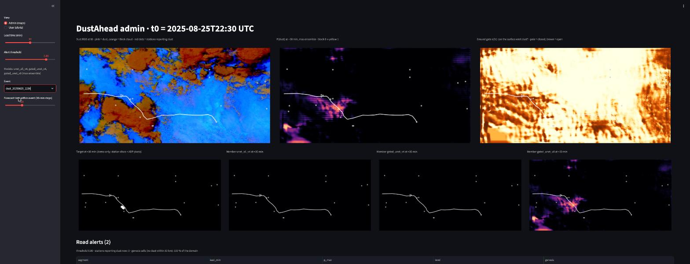
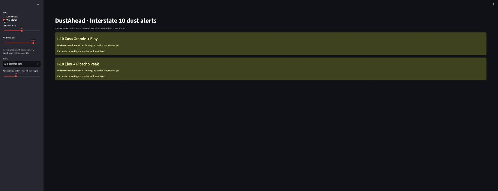

# DustAhead

**Predicting dust storms before they reach the road.** A deep-learning nowcast that warns Interstate 10
drivers in Arizona and New Mexico 15, 30 and 60 minutes before a wall of dust (haboob) arrives.

CS 7150 Deep Learning, Northeastern University (Silicon Valley), Fall 2026.
Gautam Patel · Sanidhya Chimurkar · Aayush Katoch · Professor Ilmi Yoon.

## Idea in one line
A haboob needs two things at once: a storm outflow (seen from space) and ground that can emit dust
(known from terrain, soil and a physics prior). The **gated U-Net** multiplies the two, so each factor
can be read on its own:

```
P_tau(r) = sigmoid( z_tau(r) ) * sigmoid( h(r) )
            ^ U-Net on satellite, lightning,       ^ gate CNN on static ground layers + physics prior
              weather model, station reports         (v8; earlier versions also fed it the weather model)
```

## Results so far (validation = held-out half of the 2025 events)
| Model | CSI +15 | CSI +30 | CSI +60 | Genesis CSI +60 (95 % CI) |
|---|---|---|---|---|
| Station persistence (baseline) | 0.443 | 0.354 | 0.191 | 0 |
| gated_unet v8 (static gate) | 0.508 | 0.383 | 0.210 | 0.096 [0.03, 0.13] |
| **max ensemble (product)** | **0.489** | **0.388** | **0.272** | 0.180 at the best threshold |

CSI = Critical Success Index at the best threshold; *genesis* = stations with no dust reported within 50 km at
forecast time. Full tables, intervals, p-values and the eight-version ablation: `results/val_2025_eventsplit/README.md`.
The 2026 test year is sealed and evaluated once at the end.

## The dashboard
| Admin view (Phoenix haboob, 25 Aug 2025 22:30 UTC) | User view (same forecast) |
|---|---|
|  |  |

Admin: Dust RGB, ensemble P(dust), ground gate, target and every member map, plus the segment alert table.
User: one card per I-10 segment ("Dust now / in about N min · confidence · forming or already reported · holding").

## Quick start
```bash
git clone https://github.com/gautampatel1/dustahead && cd dustahead
pip install -r requirements.txt             # Python 3.12; on the GPU PC: torch 2.11 + cu128
pytest -q                                   # ~1 min on CPU: unit, geolocation, synthetic end-to-end
python scripts/00_make_synthetic.py --small # fake samples (no internet)
python scripts/04_train.py --epochs 2       # smoke-train
streamlit run dustahead/app/dashboard.py -- --demo   # replays stored storms with the product ensemble
```

## Real data (internet, ~40 GB free, ~27 h)
| Step | Script | Source | Output |
|---|---|---|---|
| 0 | `00_check_sources.py` | every endpoint, package, GPU | preflight report |
| 1 | `01_build_event_list.py --years 2018 … 2026` | IEM NWS warnings (DS.W, SV.W) | `data/labels/events.csv` |
| 2 | `02_build_static.py` | USGS 3DEP, SoilGrids, USDA CDL | `data/static/*.npy` |
| 3 | `03_build_samples.py --workers 6` | GOES-East ABI + GLM + ADP (AWS), HRRR (Herbie), ASOS (IEM) | `data/samples/<split>/*.npz` |
| 4 | `06_index_samples.py` | — | `data/samples/index.csv` (positives per sample) |
| 5 | `04_train.py --model gated_unet [--config configs/<overlay>.yaml]` | — | `runs/<run>/best.pt` |
| 6 | `05_evaluate.py --ckpt runs/<run>/best.pt --split val` | — | `runs/<run>/eval_val.json` + `eval_val_preds.npz` |
| 7 | `07_demo_figures.py --event <id>` · `08_inspect_gate.py` · `09_slide_media.py` | — | figures for the report and slides |
| 8 | `10_live_smoke.py` | live GOES / GLM / HRRR / ASOS | end-to-end live run |

Splits: train 2018–2024 + half of the 2025 events · validate the other half of 2025 · test 2026 (run once).
`configs/default.yaml` is the single source of truth; experiments are overlays (`configs/gate_static.yaml` = v8).

## Layout
```
configs/               default.yaml + experiment overlays   dustahead/models/   gated U-Net, ablations, baselines
dustahead/grid.py      the 4 km grid                        dustahead/train/    dataset, losses, loop
dustahead/events/      warnings, Storm Events, ASOS labels  dustahead/eval/     metrics, bootstrap, evaluate
dustahead/data/        GOES, GLM, HRRR, static, physics, sampler, synthetic
dustahead/app/         predict() (ensemble, live ASOS, alert policy, hysteresis) + Streamlit dashboard
results/               evaluation JSONs and findings        scripts/  tests/   RUNBOOK_WINDOWS.md
```

See `CLAUDE.md` for the rules every contributor (human or AI) must follow, `DATA_SOURCES.md` for every endpoint,
and `RUNBOOK_WINDOWS.md` for running the build, training and the job runner on the GPU PC.
